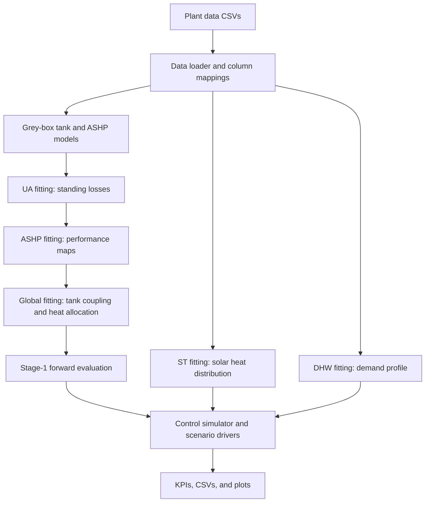

# West Whins Digital Twin

This repository contains a data-driven, grey-box digital twin of the West Whins domestic-hot-water (DHW) system, together with tools to identify its parameters and study alternative operating strategies.

The physical model represents a stratified 550 L tank as four temperature nodes (bottom, mid, mid-high, and top). It accounts for heat loss, heat transfer between adjacent nodes, solar-thermal input, air-source heat-pump (ASHP) input, and immersion heating. Around this model, the codebase provides data cleaning, parameter-fitting pipelines, simulation/evaluation tools, and tariff-aware control experiments.

## Architecture at a glance



- **Core models and data handling — `src/`:** tank heat-balance model, ASHP performance maps, solar-thermal energy calculations, data loading/cleaning, and evaluation utilities.
- **Parameter identification:** `UA_fitting/` estimates per-node standing losses; `ASHP_fitting/` estimates ASHP performance; `Global_fitting/` refines tank parameters using the UA and ASHP fits. `ST_fitting/` separately estimates how solar heat is distributed through the tank. `DHW_fitting/` derives a time-of-day and seasonal demand profile from detected draw events.
- **Evaluation — `run_stage1.py`:** loads the UA, ASHP, and global fit JSONs, simulates the tank over measured inputs, and reports train/validation temperature errors.
- **Control experiments — `src/control/` and `scripts/`:** closed-loop tank simulation, threshold baselines, model-predictive control (MPC), tariff/wind support, and scenario-specific analysis and plotting drivers.

The fitting outputs and diagnostic artefacts are written under each fitting module's `output/` and `diagnostics/` directories. General evaluation results go under `output/`; control experiments write beneath `output/control/`.

## Getting started

Use Python 3.10 or newer, install the project dependencies, and provide the plant datasets required by the workflow you intend to run. From the repository root:

```bash
python3 -m venv .venv
source .venv/bin/activate
python -m pip install -r requirements.txt
```

The data files are not interchangeable merely because they cover similar dates. Choose the column mapping that matches the selected CSV's cadence and schema. The Stage-1 defaults use the 5-minute dataset and [column_mapping_5min.yaml](column_mapping_5min.yaml). The control-study scripts are scenario drivers with their own data, tariff, and fitted-parameter paths; inspect the chosen script's settings before running it. In particular, do not substitute the 30-minute dataset for the 5-minute Stage-1 dataset without checking the data source and fit configuration.

## Typical Stage-1 workflow

The standard calibration/evaluation path is:

1. Fit tank standing losses with `UA_fitting/`.
2. Fit the ASHP maps with `ASHP_fitting/` (this consumes the UA fit).
3. Fit the remaining tank parameters with `Global_fitting/` (this consumes the UA and ASHP fits).
4. Run `run_stage1.py` to evaluate the calibrated model.

For the repository's current 5-minute Stage-1 inputs, the commands are:

```bash
python UA_fitting/run_ua_fitting.py --csv data/FullDS_Findhorn_5min.csv --yaml column_mapping_5min.yaml
python ASHP_fitting/run_ashp_fitting.py --csv data/FullDS_Findhorn_5min.csv --yaml column_mapping_5min.yaml
python Global_fitting/run_global_fitting.py --csv data/FullDS_Findhorn_5min.csv --yaml column_mapping_5min.yaml
python run_stage1.py
```

These steps create or update `UA_fitting/output/ua_fit.json`, `ASHP_fitting/output/ashp_fit.json`, and `Global_fitting/output/global_fit.json`; `run_stage1.py` writes its summary to `output/summary.json`. Each fitting module README describes its method, options, and diagnostics. `ST_fitting/` and `DHW_fitting/` are separate analyses rather than prerequisites for this Stage-1 sequence; DHW profiles are used by relevant control simulations.

## Running control studies

Control experiments are launched through individual drivers in `scripts/`, rather than a single top-level command. The drivers compare specified baselines, MPC configurations, tariffs, or evaluation windows and save their results under `output/control/`. They may rely on additional demand-profile, tariff, solar, wind, and parameter files. Review the selected driver's input paths and assumptions before running it; the scripts are research experiments, not a general-purpose CLI with uniform options.

## Data and mapping notes

- `column_mapping.yaml` and `column_mapping_5min.yaml` translate source headers and cadence assumptions into the canonical fields consumed by the models.
- The data loader standardises columns, parses timestamps, handles missing-value tokens and cumulative-meter differencing, and performs data-quality checks. Solar-thermal energy can be calculated from measured power or derived from flow and temperature difference when the required measurements are available.
- Plant-room ambient temperature is used for tank losses; estimated outdoor temperature is used by the ASHP performance model.
- For each fit or simulation, keep the CSV, mapping, sampling interval, and fitted parameters consistent. The 5-minute and 30-minute Findhorn files are distinct data sources and should not be treated as one being a simple resampling of the other.

## Tests and further reading

Run the test suite from the repository root with `pytest`. For detailed module-specific options and outputs, see the README files in `UA_fitting/`, `ASHP_fitting/`, `ST_fitting/`, and `Global_fitting/`. The principal model implementations are in `src/tank_model.py`, `src/ashp_model.py`, and `src/control/`.